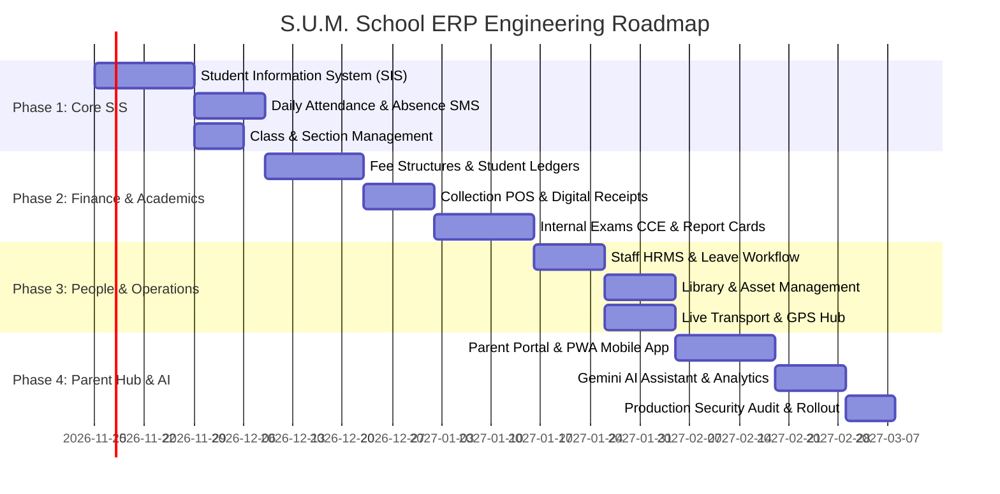

# 🎓 S.U.M. School Admin Portal Enhancement Specification
## Advanced School ERP • Campus Operating System • AI Integration • Enterprise Management

**Institution:** Savariyappa Udaiyar Memorial Higher Secondary & Primary School  
**Location:** Royappanpatti, Theni District, Tamil Nadu – 625526  
**Established:** 1963 • **UDISE:** 33250800109 (Secondary), 33250800105 (Primary)  
**Target Stack:** Next.js 16 (App Router) • React 19 • TypeScript 5 • Tailwind CSS 4 • Firebase (Firestore/Auth/Storage) • IndexedDB • Google Gemini AI

---

## 1. Executive Summary & Core Philosophy

The **S.U.M. School Administrative Management Portal (`/admin`)** currently delivers complete dynamic content management for the public school website across 24 modules. This blueprint specifies the seamless upgrade from a **Website CMS** into a full-scale **Campus Enterprise Resource Planning (ERP) System & Student Information System (SIS)**.

### Master Principles
1. **Preserve What Works:** All 24 existing public website management modules (`/admin/school-info`, `/admin/banners`, `/admin/gallery`, `/admin/events`, `/admin/results`, etc.) remain fully functional and intact.
2. **One Unified Admin Console:** Transition to a centralized dashboard where administrators, teachers, accountants, and principals manage the entire institution with single-sign-on (SSO).
3. **Dual-Engine Resilience:** Continue leveraging Google Cloud Firestore for real-time cloud persistence paired with client-side IndexedDB for rural offline classroom reliability.
4. **Zero Trust on Sensitive Operations:** Sensitive financial transactions, official certificate issuance, and year-end promotions are strictly verified server-side with immutable audit logging.

---

## 2. Complete Admin Portal Navigation & Routing Architecture

```
/admin
├── 📊 Dashboard (/admin)
│
├── 🏛️ INSTITUTION
│   ├── School Profile & Accreditations (/admin/school-info)
│   ├── Academic Years & Terms (/admin/academic-years) [NEW]
│   ├── Classes & Section Allocation (/admin/classes) [NEW]
│   └── Heritage & Research Archive (/admin/research)
│
├── 🎓 STUDENTS
│   ├── Student Directory & Dossier (/admin/students) [NEW]
│   ├── Admission Applications (/admin/enquiries)
│   ├── Daily Attendance & SMS Dispatch (/admin/attendance) [NEW]
│   ├── Student ID Cards & QR Badges (/admin/documents/id-cards) [NEW]
│   ├── Transfer & Bonafide Certificates (/admin/documents) [NEW]
│   └── Year-End Student Promotion (/admin/students/promotion) [NEW]
│
├── 📚 ACADEMICS
│   ├── Curricular Streams & Syllabus (/admin/academics)
│   ├── Internal Examinations & CCE (/admin/examinations) [NEW]
│   ├── Board Examination Registry (/admin/results)
│   ├── Digital Report Cards (/admin/examinations/report-cards) [NEW]
│   ├── Digital Classroom & Homework (/admin/classroom) [NEW]
│   └── Master Timetable & Conflict Engine (/admin/timetable) [NEW]
│
├── 💰 FINANCE & ACCOUNTS
│   ├── Fee Structures & Categories (/admin/fees/structures) [NEW]
│   ├── Student Fee Accounts & Ledgers (/admin/fees/students) [NEW]
│   ├── Fee Collection & Counter POS (/admin/fees/collection) [NEW]
│   ├── Digital Receipts & Invoices (/admin/fees/receipts) [NEW]
│   ├── Scholarships & Concessions (/admin/fees/concessions) [NEW]
│   └── Financial Audit & Dues Reports (/admin/fees/reports) [NEW]
│
├── 👥 PEOPLE & HR
│   ├── Faculty & Staff Profiles (/admin/faculty)
│   ├── Staff Attendance & Biometrics (/admin/hr/attendance) [NEW]
│   ├── Leave Applications & Workflow (/admin/hr/leaves) [NEW]
│   ├── Payroll & Payslip Generation (/admin/hr/payroll) [NEW]
│   └── Parent Accounts & Child Mapping (/admin/parents) [NEW]
│
├── 🚌 CAMPUS OPERATIONS
│   ├── Transport Routes & Fleet (/admin/transport)
│   ├── Live GPS & Vehicle Operations (/admin/transport-management) [NEW]
│   ├── Central Library Management (/admin/library) [NEW]
│   ├── Campus Inventory & Asset Registry (/admin/inventory) [NEW]
│   └── Infrastructure Facilities (/admin/facilities)
│
├── 📢 COMMUNICATION & GRIEVANCE
│   ├── Announcements & Circulars (/admin/announcements)
│   ├── WhatsApp / SMS Broadcast Center (/admin/notifications) [NEW]
│   ├── Parent & Staff Grievance Redressal (/admin/complaints) [NEW]
│   └── Events Calendar & Milestones (/admin/events)
│
├── 🌐 PUBLIC WEBSITE CONTENT
│   ├── Hero Carousel Banners (/admin/banners)
│   ├── Homepage Stats & Headmaster Message (/admin/homepage)
│   ├── About School & Founder Profiles (/admin/about)
│   ├── Photo & Media Gallery (/admin/gallery)
│   ├── Achievements & Honors (/admin/achievements)
│   ├── 60+ Years Alumni Network (/admin/alumni)
│   ├── Testimonials & Reviews (/admin/testimonials)
│   └── Brand Theme & Colors (/admin/theme)
│
├── 🤖 INTELLIGENCE & ANALYTICS
│   ├── Google Gemini AI Assistant (/admin/ai-assistant) [NEW]
│   ├── Institutional Analytics & BI (/admin/analytics) [NEW]
│   ├── UDISE & Management Reports (/admin/reports) [NEW]
│   └── Global Search & Command Center (Ctrl+K) [NEW]
│
└── 🔒 SYSTEM & SECURITY
    ├── Staff User Accounts (/admin/users)
    ├── Role-Based Permission Matrix (/admin/users/permissions) [NEW]
    ├── Immutable Audit Activity Trail (/admin/system/audit-logs) [NEW]
    ├── Error Monitoring & Diagnostic Hub (/admin/system/errors) [NEW]
    ├── Cloud Backup & Migration Hub (/admin/migration)
    ├── 30-Day Soft-Delete Recycle Bin (/admin/system/recycle-bin) [NEW]
    └── Website SEO & Settings (/admin/settings)
```

---

## 3. Detailed Technical Specifications by Functional Pillar

### Pillar 1: Student Information System (SIS) & Lifecycle Automation
* **Route:** `/admin/students`
* **Student Admission Number Generator:** Standardized unique ID generated upon admission approval:
  $$\text{Admission ID} = \text{SUM} / \text{EnrollmentYear} / \text{Standard} / \text{Sequence}$$
  *Example:* `SUM/2026/11CS/0042`
* **Student Profile Dossier:** Complete 360° record including Tamil and English full names, Aadhaar token, EMIS 16-digit ID, community certificate verification (BC/MBC/SC/ST), religion, blood group, parent details, plantation worker status, and village landmark.
* **Annual Promotion Engine:** Bulk promote students from Class $N$ to $N+1$ with section re-allocation.
* **Transfer Certificate (TC) Engine:** Automated generation of Tamil Nadu School Education Department-compliant Transfer Certificates with anti-tamper QR code verification.

### Pillar 2: Daily Attendance & Instant SMS/WhatsApp Dispatch
* **Route:** `/admin/attendance`
* **Period-Wise / Session Roll Call:** Class teachers mark morning and afternoon attendance in less than 60 seconds with bulk selection.
* **Automated Absence SMS Trigger:** When an absence is submitted, the server queues a bilingual SMS/WhatsApp notice:
  > *"Dear Parent, your ward [Student Name] was marked ABSENT on [Date] at S.U.M. Hr Sec School. Contact office: 04554-290000."*
* **75% Mandatory Board Exam Alert:** Visual heatmaps highlight students at risk of falling below the 75% minimum attendance rule for Government Board Examinations.

### Pillar 3: Fees, Accounts & Concession Finance Engine
* **Route:** `/admin/fees`
* **Multi-Tier Fee Heads:** Tuition, Term, Laboratory, Smart Class, Computer Lab, Transportation, and Hostel fees.
* **Special Subsidies & Concessions:** 100% tuition concession for children of plantation laborers and scholarships funded by the S.U.M. Alumni Trust.
* **Payment Recording:** Multi-mode receipting (Cash Counter, Bank Transfer, UPI QR, and online gateway integration).
* **Automated POS / PDF Receipts:** Dual-copy (Student & School Office) printable 80mm POS slip or formal A5 receipt with UDISE registration metadata.

### Pillar 4: Internal Examination & CCE Report Card Engine
* **Route:** `/admin/examinations`
* **Continuous Comprehensive Evaluation (CCE):** Manage Unit Tests (1–4), Mid-Term, Quarterly, Half-Yearly, Revision Tests, and Annual Public Mock Examinations.
* **Scoring Rules:** Standard Tamil Nadu State Board grading scheme with Theory, Practical, and Internal Assessment marks.
* **Automated Report Card Generation:** 1-click batch generation of bilingual PDF progress cards with subject grades, total scores, class rank, attendance percentage, teacher remarks, and Headmaster signature block.

### Pillar 5: Digital Classroom & Homework Engine
* **Route:** `/admin/classroom`
* **Assignment Workflow:** Teachers upload homework instructions, due dates, and PDF learning materials.
* **Submission Tracking:** Real-time visibility into students who have submitted, pending submissions, and overdue assignments.
* **Teacher Feedback & Marks:** Digital grading with qualitative feedback visible on the Parent Portal.

### Pillar 6: Parent & Guardian Portal
* **Route:** `/parent` (Dedicated mobile-optimized interface)
* **Secure Authentication:** Mobile number + OTP verification or password login.
* **Multi-Child Dashboard:** Switch seamlessly between siblings enrolled across Primary, High School, and Higher Secondary.
* **Instant Access:** Real-time attendance calendar, report cards, fee dues with online pay button, bus route tracking, and school circulars.

### Pillar 7: Staff, HR & Payroll Lifecycle
* **Route:** `/admin/hr`
* **Staff Profiles:** Teaching and non-teaching personnel, subject allocations, TRB registration, and service history.
* **Leave Management:** Casual Leave (CL), Medical Leave (ML), Earned Leave (EL) tracking with digital approval workflow.
* **Payroll & Payslips:** Monthly allowance and deduction calculations with 1-click PDF payslip generation.

### Pillar 8: Campus Operations & Fleet Management
* **Transport Operations (`/admin/transport-management`):** Student-to-bus allocations, driver attendance, vehicle fitness certificate (FC) & insurance expiry alerts, and live GPS integration.
* **Library Management (`/admin/library`):** Book cataloging with ISBN, rack locations, barcode/QR loan checkout, return tracking, and overdue fine management.
* **Inventory & Asset Management (`/admin/inventory`):** Registry of computers, laboratory equipment, classroom furniture, and sports apparatus with warranty and maintenance history.
* **Grievance Redressal (`/admin/complaints`):** Tracking parent and staff concerns through a 4-stage resolution pipeline (`Submitted` ➔ `In Review` ➔ `Resolved` ➔ `Closed`).

### Pillar 9: Multi-AI Provider Orchestration & Intelligence Center
* **Routes:** `/admin/ai-assistant` (Interactive Copilot Studio), `/admin/ai-settings` (Provider Controls)
* **Provider-Agnostic Adapter:** Native server-side integration supporting:
  - **Google Gemini** (Primary — Gemini 2.0 Flash, Gemini 1.5 Pro, Gemini 1.5 Flash): Optimized for multilingual Tamil reasoning and instantaneous response speed.
  - **OpenAI ChatGPT** (Secondary / Fallback — GPT-4o, GPT-4o-mini): High-precision reasoning and linguistic drafting.
  - **Claude & Perplexity:** Pre-architected interface definitions ready for future API enablement.
* **Zero-Downtime Automatic Failover:** If the primary provider experiences quota limits or network timeouts, the orchestrator automatically reroutes the prompt to the secondary provider without administrative disruption.
* **Server-Side Security & PII Protection:** API keys are never leaked to frontend code or public Firestore databases. The proxy engine automatically scrubs student Aadhaar numbers and parent contact numbers before transmission.
* **Human-in-the-Loop Governance:** AI drafts circulars, notices, and replies; explicit administrator approval is mandatory before any public publishing or parent dispatch.

### Pillar 10: Super Admin Control Center & Audit Governance
* **Route:** `/admin/system`
* **Immutable Audit Trail:** Log every administrative update with user ID, IP address, timestamp, and field-level diff.
* **Role-Based Access Control (RBAC):** Granular permissions across 10 defined institutional roles.
* **System Health & Database Sync:** Firestore cloud usage counters, IndexedDB local synchronization state, and automated encrypted backup scheduler.

---

## 4. Database Schema Specifications (Firestore & IndexedDB)

```typescript
// 1. Student Profile & Dossier
export interface StudentProfile extends FirestoreDoc {
  admissionNumber: string; // "SUM/2026/11CS/0042"
  emisNumber?: string;     // 16-digit TN EMIS ID
  rollNumber: string;
  name_en: string;
  name_ta: string;
  dob: string;             // "YYYY-MM-DD"
  gender: 'male' | 'female' | 'other';
  bloodGroup?: string;
  community: 'OC' | 'BC' | 'MBC' | 'SC' | 'ST';
  religion: string;
  aadhaarToken?: string;   // Encrypted/tokenized
  photoUrl: string;
  standard: string;        // "11th Standard"
  stream?: string;          // "Computer Science", "Bio-Maths", "Commerce"
  section: 'A' | 'B' | 'C';
  medium: 'tamil' | 'english';
  academicYear: string;    // "2025–2026"
  parentDetails: {
    fatherName: string;
    motherName: string;
    guardianName?: string;
    primaryPhone: string;
    secondaryPhone?: string;
    email?: string;
    occupation: string;
    isPlantationWorker: boolean;
    residentialAddress: string;
  };
  transportRouteId?: string;
  isHosteller: boolean;
  status: 'active' | 'transferred' | 'alumni' | 'suspended';
}

// 2. Daily Attendance Record
export interface DailyAttendanceRecord extends FirestoreDoc {
  date: string;            // "YYYY-MM-DD"
  academicYear: string;
  standard: string;
  section: string;
  session: 'morning' | 'afternoon';
  takenByStaffId: string;
  takenByStaffName: string;
  records: Array<{
    studentId: string;
    admissionNumber: string;
    studentName: string;
    status: 'present' | 'absent' | 'late' | 'half_day';
    remarks?: string;
  }>;
  totalStudents: number;
  presentCount: number;
  absentCount: number;
  notificationSent: boolean;
}

// 3. Fee Structure Definition
export interface FeeStructure extends FirestoreDoc {
  academicYear: string;
  standard: string;
  stream?: string;
  medium: 'tamil' | 'english';
  feeCategory: 'regular' | 'hosteller' | 'transport_only';
  lineItems: Array<{
    headName: string;      // "Tuition", "Lab", "Smart Class", "Exam"
    amount: number;
    isMandatory: boolean;
  }>;
  totalAnnualFee: number;
  termBreakup: {
    term1: number;
    term2: number;
    term3: number;
  };
}

// 4. Student Fee Account & Ledger
export interface StudentFeeAccount extends FirestoreDoc {
  studentId: string;
  admissionNumber: string;
  studentName: string;
  standard: string;
  academicYear: string;
  baseAmount: number;
  concessionAmount: number;
  concessionReason?: string; // "Plantation Laborer Subsidy"
  netPayableAmount: number;
  totalPaid: number;
  balanceDue: number;
  status: 'paid' | 'partial' | 'pending';
  lastPaymentDate?: string;
}

// 5. Fee Transaction & Official Receipt
export interface FeeTransaction extends FirestoreDoc {
  receiptNumber: string;   // "SUM-REC-2026-0842"
  studentId: string;
  admissionNumber: string;
  studentName: string;
  standard: string;
  academicYear: string;
  paymentMode: 'cash' | 'upi' | 'bank_transfer' | 'concession_grant';
  transactionReference?: string;
  amountPaid: number;
  breakup: Array<{
    headName: string;
    amount: number;
  }>;
  balanceRemaining: number;
  receivedByUserId: string;
  receivedByUserName: string;
  receiptTimestamp: string;
}

// 6. Internal Examination & CCE Assessment
export interface ExaminationSetup extends FirestoreDoc {
  examName: string;        // "Quarterly Examination"
  academicYear: string;
  applicableStandards: string[];
  startDate: string;
  endDate: string;
  status: 'scheduled' | 'ongoing' | 'evaluating' | 'published';
  subjects: Array<{
    subjectCode: string;
    subjectName: string;
    maxTheoryMarks: number;
    maxPracticalMarks: number;
    maxInternalMarks: number;
    totalMaxMarks: number;
    passingMarks: number;
  }>;
}

// 7. Student Exam Marksheet Record
export interface StudentInternalMarksheet extends FirestoreDoc {
  examId: string;
  examName: string;
  academicYear: string;
  studentId: string;
  admissionNumber: string;
  studentName: string;
  standard: string;
  section: string;
  marks: Array<{
    subjectCode: string;
    subjectName: string;
    theoryMarks: number;
    practicalMarks?: number;
    internalMarks?: number;
    totalMarks: number;
    grade: string;
    isPassed: boolean;
  }>;
  grandTotal: number;
  grandMaxMarks: number;
  percentage: number;
  classRank?: number;
  overallGrade: string;
  overallStatus: 'PASS' | 'FAIL';
  teacherRemarks?: string;
}

// 8. Staff Profile & Employment Record
export interface StaffProfile extends FirestoreDoc {
  staffId: string;         // "SUM-FAC-014"
  name_en: string;
  name_ta: string;
  photoUrl: string;
  designation: string;     // "PG Assistant in Chemistry"
  department: 'Primary' | 'High School' | 'Higher Secondary' | 'Admin';
  qualification: string;
  joiningDate: string;
  phone: string;
  email: string;
  assignedClasses: Array<{
    standard: string;
    section: string;
    subject: string;
    isClassTeacher: boolean;
  }>;
  status: 'active' | 'on_leave' | 'resigned';
}

// 9. Central Library Book Record
export interface LibraryBook extends FirestoreDoc {
  isbn?: string;
  accessionNumber: string; // "LIB-2026-0412"
  title: string;
  author: string;
  publisher: string;
  category: 'Tamil Literature' | 'Science' | 'Mathematics' | 'General Reference';
  totalCopies: number;
  availableCopies: number;
  rackLocation: string;   // "Rack 3 - Shelf B"
}

// 10. Immutable Administrative Audit Log
export interface AdminAuditLog extends FirestoreDoc {
  timestamp: string;
  actorUserId: string;
  actorUserName: string;
  actorRole: string;
  module: string;          // "students", "fees", "examinations", "users"
  action: 'create' | 'update' | 'delete' | 'promote' | 'publish' | 'export';
  targetDocumentId: string;
  ipAddress?: string;
  changeSummary: string;
  previousData?: Record<string, unknown>;
  newData?: Record<string, unknown>;
}
```

---

## 5. Role-Based Access Control (RBAC) Matrix

| Institutional Role | SIS (/students) | Attendance | Fees & Billing | Exams & CCE | HR & Payroll | Library & Assets | Website CMS | System & Backups |
| :--- | :---: | :---: | :---: | :---: | :---: | :---: | :---: | :---: |
| **Super Admin** | Full | Full | Full | Full | Full | Full | Full | Full |
| **Principal** | View, Edit | View | View | Full Approval | View | View | Full | View Logs |
| **School Admin** | Full | Full | Full | View, Publish | Full | Full | Full | Sync & Backups |
| **Accountant** | View | None | Full Control | None | Payroll View | Assets Edit | None | None |
| **Class Teacher** | View Class | Mark & Edit | None | Entry Class | Leave Apply | View | None | None |
| **Exam Coordinator**| View | None | None | Full Setup & Edit | None | None | None | None |
| **Librarian** | View | None | None | None | None | Full Library | None | None |
| **Transport Manager**| View Route | None | None | None | None | Full Transport | None | None |
| **Content Editor** | None | None | None | None | None | None | Full | None |
| **Parent** | Own Child | Own Child | Own Dues & Pay | Own Child | None | None | Public View | None |

---

## 6. Phased Implementation Roadmap



---

## 7. Definition of Done & Quality Acceptance Criteria

Before any ERP module transitions to production, it must fulfill the following verification gates:
1. **Zero Mock Data in Production:** All initial demo records cleanly purgable via [`/admin/migration`](file:///d:/project/sum/src/app/admin/migration/page.tsx).
2. **Atomic Financial Consistency:** All fee collections execute inside Firestore atomic transactions (`runTransaction`) with guaranteed idempotency.
3. **Double Verification on Sensitive Outputs:** Generated marksheets and Transfer Certificates embed non-guessable verification hashes and printable QR validation links.
4. **Bilingual Completeness:** All form field labels, error messages, and table headers render cleanly in both English and literary Tamil (`LanguageContext.tsx`).
5. **Rural Offline Resilience:** Classroom attendance and student lookups execute offline in browser IndexedDB and sync seamlessly upon network reconnection.
